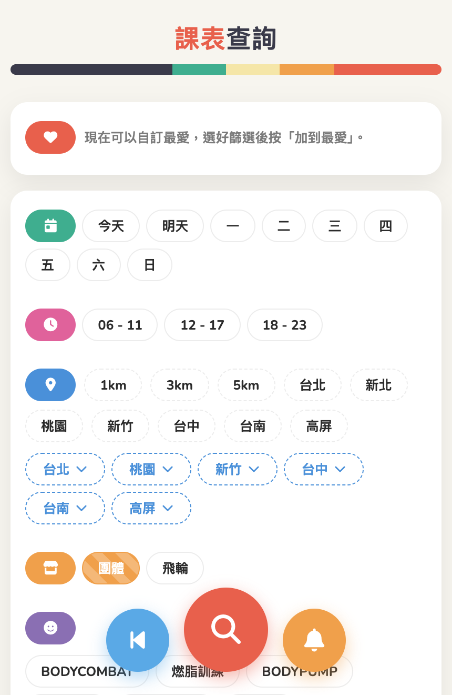

# 🏋️ World Gym 課表查詢

查詢 World Gym 台灣各分店團體課表的網站。前端是純靜態頁面（沒有 build step、沒有框架），後端用 Cloudflare Worker + D1 資料庫，靜態站放在 Cloudflare Pages。

這是使用 Claude 寫的。



線上版本：
- 網站（Cloudflare Pages）：https://worldgym.pages.dev
- API（Cloudflare Worker）：https://worldgym-api.lions2100.workers.dev

> 給 AI 協作者看的維護細節（為什麼這樣設計、改動時的注意事項）在 [`CLAUDE.md`](CLAUDE.md)，這份 README 是給人看的專案總覽。

## ✨ 功能

- **查課表**：依星期（含「今天」「明天」快捷）、時段（06–11 / 12–17 / 18–23）、分店（110 間，依縣市分區可展開收合、可搜尋、可整個縣市或分區全選，也能依目前位置篩選 1／3／5 公里內的分店）、教室（團體／飛輪）、課程、老師組合查詢。結果同頁顯示；固定班一週只列一筆，8～14 天後的代課逐筆列出並標警示；超過 250 筆會提示縮小條件。點結果裡的老師名字可直接用該老師重新查詢。
- **記住你的選擇**：上次勾選的條件存在瀏覽器（`localStorage`），可「清除記憶」；「我的最愛」可自訂名稱、圖示與顏色，一鍵套用並查詢。
- **分享**：複製結果文字、複製分享網址（篩選條件編碼在網址裡，分店用短代碼）。
- **推播提醒（PWA）**：加到主畫面後，結果列會出現鈴鐺，可登記單次通知，課前 30／60／90 分鐘自選。
- **通知頁**：已登記的提醒清單、查詢量趨勢與老師／課程／分店查詢排行（公開）、寫信給作者（轉發到 Teams）。
- **後台**（`/admin`）：廣告、最愛、提醒的使用量報表、IP 存取紀錄、手動重抓課表。
- **對搜尋引擎與 AI 友善**：單一分店網址會在伺服器端注入該分店課表，並提供動態 sitemap 與 llms.txt（見下方「SEO 與爬蟲」）。
- 前端另外埋了 GA4 事件（篩選、查詢、登記／取消提醒等），事件清單見 [`GA_EVENTS.md`](GA_EVENTS.md)。

## 🏗️ 架構

```
.
├── index.html / script.js / style.css   # 前台：課表查詢頁、首頁廣告橫幅、首頁公開排行報表
├── common.js                            # 前後台共用：HTML 跳脫、fetchJson、自製下拉選單、月份計算、折線圖工廠、下拉重新整理
├── ga-init.js                           # GA4 初始化（只有 index.html 載入，必須同步載入；因 CSP 不允許 inline script 而獨立成檔）
├── css-async.js                         # 非阻塞載入 Font Awesome CSS（同樣是為了 CSP；index.html、admin.html 都載入）
├── admin.html / admin.js                # 後台：登入、報表（Chart.js）、手動重抓與清除孤兒資料
├── vendor/chart.umd.min.js              # Chart.js（vendor 進來，不吃 CDN）
├── manifest.json / sw.js / icons/       # PWA 設定與 Service Worker（推播提醒用）
├── 404.html / robots.txt / sitemap.xml / llms.txt   # sitemap.xml 與 llms.txt 是動態版失敗時的備援靜態檔
├── _headers                             # Pages 回應標頭：CSP 等安全標頭、CSS／JS／icon 的 30 天快取
├── functions/                           # Cloudflare Pages Functions（跟靜態站一起部署）
│   ├── _middleware.js                   #   只放行台灣 IP（爬蟲例外）、擋掉不屬於網站的檔案（worker/、*.md、點開頭的檔案）
│   ├── index.js                         #   單一分店網址在伺服器端注入課表
│   ├── sitemap.xml.js / llms.txt.js     #   動態 sitemap 與 llms.txt
│   └── _lib/                            #   注入、sitemap、llms 的實作與共用工具
├── hosting/                             # 只用於本機開發：dev.mjs 啟動 wrangler 靜態伺服器（不是正式部署目標）
├── docs/screenshot.png
└── worker/                              # Cloudflare Worker API
    ├── wrangler.toml                    #   D1 / KV 綁定、cron 排程
    ├── schema.sql                       #   D1 完整 schema（重建資料庫用，會 DROP 所有表）
    ├── migrations/                      #   針對既有正式資料庫的單張 table migration
    ├── scripts/check-branches.mjs       #   分店清單一致性檢查（npm run check:branches）
    ├── scripts/check-versions.mjs       #   靜態資源 ?v= 版號檢查（npm run check:versions）
    └── src/
        ├── index.js                     #   路由表 ROUTES（限流、後台驗證統一處理）、CORS、入口、cron scheduled()
        ├── queryClasses.js              #   課表查詢邏輯
        ├── scrape.js                    #   爬蟲：抓官網課表寫入 D1
        ├── branchScan.js                #   每月比對官網 sitemap，發現新分店或疑似下架就通知 Teams
        ├── reminders.js                 #   課前推播提醒：登記、取消、到期發送 Web Push
        ├── analytics.js                 #   報表的「明細＋月度彙總」查詢與每月壓縮
        ├── crawlers.js                  #   海外 IP 存取判斷與爬蟲 UA 清單（Pages 的中介層也用）
        ├── util.js                      #   共用小工具：台灣時間、fnv1aHex、爬官網的 UA、推 Teams（functions/ 也會 import）
        ├── branches-seed.js             #   分店清單固定資料（slug 對應官網 find-a-club/{slug}）
        └── branches-excluded.js         #   已知不收的分店（Express、付費課）與預售分店，月度掃描不重複通知
```

### 排程（`worker/wrangler.toml` 的 cron，時間為台灣時間）

| cron | 時間 | 做什麼 |
| --- | --- | --- |
| `*/5 * * * *` | 每 5 分鐘 | 掃描課前推播是否到期並送出 |
| `0 19 * * *`、`0 9 * * *` | 每天 03:00、17:00 | 重抓全部分店課表（需要 Workers Paid：單次執行要發一百多個 subrequest，免費方案上限只有 50） |
| `0 20 1 * *` | 每月 1 號 04:00 | 兩件互不相關的事：①把**當月以前**（實務上就是剛結束的上個月）的報表明細壓縮成月度彙總並刪掉明細；②另外清掉 90 天前的 `query_access_log`（這個「90 天」只針對這張存取紀錄表，跟報表明細無關） |
| `0 21 2 * *` | 每月 2 號 05:00 | 比對官網 sitemap 與 `branches-seed.js`，有差異才發 Teams 通知（只通知，不會自動改資料）；`branches-excluded.js` 裡已知不收的網址不算差異 |

也可以在 `admin.html` 手動重抓。

### API 端點（都在 `worker/src/index.js` 的 `ROUTES` 表，`limit` 是每 IP 每分鐘上限）

| 類別 | 端點 | 說明 |
| --- | --- | --- |
| 查詢 | `GET /issueToken`（10）、`POST /queryClasses`（20）、`GET /filterOptions`（60） | 課表查詢與篩選選項，見「防濫用機制」 |
| 公開讀取 | `GET /ads`（60）、`GET /publicSearchStats`、`/publicTeacherStats`、`/publicCourseStats`、`/publicBranchStats`（各 30） | 廣告與首頁公開排行 |
| 打點 | `POST /trackAdEvent`（60）、`/trackAdEvents`（20）、`/trackSearchEvents`（20）、`/trackSearch`（60）、`/trackFavorite`（60） | 使用量統計，內容會驗證（見「防濫用機制」） |
| 推播提醒 | `POST /registerReminder`、`/cancelReminder`、`GET /myReminders`（各 60） | 見「推播提醒」 |
| 其他 | `POST /sendMessageToAuthor`（5） | 留言轉發到 Teams |
| 後台 | `POST /verifyAdminToken`（10）、`GET /adStats`、`/favoriteStats`、`/reminderStats`、`/queryAccessStats`（各 30）、`GET /scrapeManual`、`POST /scanNewBranches`、`/cleanupStaleBranches`、`/rollupAnalyticsManual`（各 5） | 除登入外都要帶 session token；`/scrapeManual` 以串流回傳進度 |

## 🗄️ 資料表總覽

D1（`worldgym-schedule`）的 table，完整欄位以 [`worker/schema.sql`](worker/schema.sql) 為準：

| Table | 用途 |
| --- | --- |
| `classes` | 爬蟲抓下來的課表（分店、日期、課程、老師、教室、是否代課） |
| `branches` | 分店清單（slug、名稱、地區） |
| `meta_filter_options` | 篩選用的課程／老師名稱清單快取（爬蟲跑完才更新） |
| `reminders` | 課前推播提醒的登記與發送狀態 |
| `reminder_add_events` / `reminder_add_monthly` | 提醒功能使用量：只記「登記」被觸發幾次，不分辨是不是同一人、不追蹤取消 |
| `ads` | 首頁廣告內容與上下架時間（`schema.sql` 末尾有初始廣告的 INSERT） |
| `ad_events` / `ad_monthly` | 廣告曝光／點擊明細與月度彙總 |
| `teacher_search_events` / `course_search_events` / `branch_search_events`（各有 `*_monthly`） | 老師／課程／分店被查詢的次數 |
| `search_events` / `search_monthly` | 整體查詢次數與結果數 |
| `favorite_events` / `favorite_monthly` / `favorite_client_seen` | 「我的最愛」建立／使用；`favorite_client_seen` 即時維護全時間去重人數，不受明細清理影響 |
| `query_access_log` | `/issueToken`、`/queryClasses` 的存取紀錄（IP、UA、是否被限流），事後排查爬蟲或腳本，每月清 90 天前的 |

**時間戳一律用台灣時間（`+08:00`），不是 UTC**，包含 `createdAt`、`updatedAt`、`scrapedAt`、`ads.startAt`／`endAt`：都是位移 8 小時再貼 `+08:00` 後綴的 ISO 字串，才能直接用字串比較與排序。程式裡一律用 `worker/src/util.js` 的 `nowTaiwanIso()` 等函式產生，不要自己寫 `Date.now() + 8 * 3600 * 1000`，也不要混用 `toISOString()`（那是 UTC）。報表「這個月」的預設值也照台灣時間判斷。

### 爬蟲寫入方式

`worker/src/scrape.js` 每輪對每間分店：先把這一輪抓到的全部列 upsert 進 `classes`（`ON CONFLICT(id) DO UPDATE`，只更新同一個 id 下還可能變的欄位），最後在最後一批裡刪掉「這間分店 `scrapedAt` 比這一輪舊」的列。**不是**先整間刪光再重寫——那樣寫入的幾百毫秒到幾秒內，這間分店是空的或只有一部分，剛好有人查詢或 sitemap 在此時重建並快取，就會看到殘缺資料。同一間分店同一輪的所有列共用同一個 `scrapedAt`，它是新舊資料的分水嶺。每輪存今天起 14 天，其中前 8 天存全部課，之後只存代課。

### 分析報表明細轉月度彙總

`teacher_search_events`、`course_search_events`、`branch_search_events`、`search_events`、`favorite_events`、`ad_events`、`reminder_add_events` 這些事件明細表**只保留當月**，上個月一結束就由每月排程（`rollupAnalyticsEvents()`）壓縮成對應的 `*_monthly` 彙總表並刪除明細。彙總表保留報表實際用到的完整維度（例如老師排行留「月份＋老師名」各自的次數），所以之後想把「前 15 名」改成「前 20 名」不需要任何資料回填。

所有報表查詢都是「彙總表 `UNION ALL` 明細表」，兩者依月份天生互斥；彙總寫入與刪除明細包在同一個 `db.batch()` 裡原子執行，不會有同一個月被重複計算的瞬間。「累積建立人數」是例外，靠 `favorite_client_seen` 即時維護，不依賴明細。想手動確認或補跑，可用 admin token 呼叫 `POST /rollupAnalyticsManual`。

## 🔔 推播提醒（PWA）

要先把課表頁加到主畫面成為 PWA 才會顯示鈴鐺（`script.js` 的 `isPWAInstalled()` 判斷 `display-mode: standalone`）。流程：

1. 點鈴鐺跳出小視窗，選課前 30／60／90 分鐘；前端透過 `sw.js` 註冊 Service Worker、跟瀏覽器要 Push 訂閱，連同上課資訊與選的分鐘數打 `/registerReminder` 存進 D1（後端只收這三個值，沒帶視為 30）。
2. Worker 的 cron 每 5 分鐘掃 D1，找出快到上課時間、還沒發送的提醒。
3. `worker/src/reminders.js` 組出推播內容（標題「課程名 老師」，內文「分店 週幾 時間」），用 VAPID 金鑰簽署後送給瀏覽器的 Push 服務；送完（不論成功、訂閱失效或失敗）就刪除該筆，不重試。
4. 瀏覽器收到後由 `sw.js` 的 `push` 事件顯示通知；點通知會開啟登記當時的查詢頁。

安全上有幾個限制：推播的目標網址（`subscriptionEndpoint`）只接受主流 Push 服務的網域（FCM、Mozilla、Apple、Windows），避免被拿來讓 Worker 去打任意網址；登記時帶的 `clickUrl` 只接受本站網址；取消提醒一定要帶對「登記當時那個裝置的訂閱網址」，不能只憑提醒 id（id 是非安全用途的雜湊）。

本機測試可在網址加 `?pwa=1`（等同 `localStorage.setItem("wg_debug_force_pwa","1")`），不用真的安裝成 PWA 就能看到鈴鐺。

## 📢 首頁廣告

廣告存在 D1 的 `ads` 表（`text`、`url`、`startAt`、`endAt`、`enabled`、`sortOrder`）。前端載入時打 `GET /ads`，只拿回「在上下架時間內且 `enabled = 1`」的廣告，隨機挑一則顯示；拿不到任何廣告時整條橫幅隱藏。**沒有輪播**——每次載入頁面隨機選一則，固定到重新整理為止。廣告連結只接受 `http(s)`。

臨時下架某則廣告，把 `enabled` 改成 `0` 即可：

```bash
cd worker
npx wrangler d1 execute worldgym-schedule --remote --command="UPDATE ads SET enabled=0 WHERE id='ad-1'"
```

## 🔑 後台登入

`admin.html` 用一組共用密碼登入（對應 Worker 的 `MANUAL_SCRAPE_TOKEN` secret），沒有帳號系統，拿到密碼的人都能登入。

1. 輸入密碼後打 `POST /verifyAdminToken`，Worker 把傳入值與 `MANUAL_SCRAPE_TOKEN` 各自雜湊成固定長度，用 `timingSafeEqual` 做常數時間比較。成功會換發一張**簽章、7 天效期**的 session token（payload 只有 `exp`）。簽章金鑰優先用獨立的 `ADMIN_SESSION_SECRET`（至少 32 字元的隨機字串）；沒設才退回從 `MANUAL_SCRAPE_TOKEN` 雜湊衍生，這種做法在 session token 外洩時，攻擊者能離線猜密碼，所以建議一定要設。
2. 前端把 session token（不是密碼）存進 `localStorage`，之後每次後台操作用 `X-Admin-Token` header 帶著送。
3. 每次重新開啟後台都會重新驗證並換發新 token（滑動延長），7 天內有開過就不用重新輸入密碼。
4. 只有 `/verifyAdminToken` 接受「直接帶密碼」，其餘後台端點只認 session token，這樣無法繞過登入保護去對別的端點猜密碼。
5. **登入失敗鎖定**：同一個 IP 連續輸錯 5 次，就鎖定 15 分鐘（記在 KV 的 `admin-fail:<IP>`）；鎖定期間**連正確密碼也會被拒絕**，畫面會顯示「嘗試次數過多，已暫時鎖定」，等解除再輸入一次即可。

## 📊 後台報表與操作

登入後有三個報表面板與一張存取紀錄表：

| 面板 | 資料來源 | 內容 |
| --- | --- | --- |
| 廣告 | `ad_events` / `ad_monthly` | 每則廣告（或全部加總）近 12 個月的曝光／點擊折線圖，可翻頁切換月份視窗 |
| 最愛 | `favorite_events` / `favorite_monthly` / `favorite_client_seen` | 累積建立人數（全時間去重）、累積使用次數，近 12 個月折線圖 |
| 提醒 | `reminder_add_events` / `reminder_add_monthly` | 累積登記次數，近 12 個月折線圖（沒紀錄的月份補 0），用來評估功能有沒有人用 |
| 存取紀錄 | `query_access_log` | 依 IP 分組列出 `/issueToken`、`/queryClasses` 的次數與被限流次數，可切換 7／14／30 天；請求間隔過於規律的 IP 會標色 |

折線圖用 [Chart.js](https://www.chartjs.org/)（`vendor/chart.umd.min.js`），共用的 `createLineChart()` 在 `common.js`。另有一個終端機面板：「重抓全部分店」（需二次確認，進度即時串流顯示）、「清除已停用分店的舊資料」，以及 Cloudflare 資料庫、Google Analytics、Cloudflare Web Analytics 的快速連結。

網站沒有帳號系統，「幾個人」的統計靠前端 `localStorage` 裡的匿名 `wg_client_id`（`crypto.randomUUID()`，最愛功能用），後端用 `COUNT(DISTINCT clientId)` 估算，不對應任何真實身分；GA4 事件同樣只看使用量。

新增報表面板的流程：在 `worker/src/index.js` 的 `ROUTES` 表加一個打點端點與一個 `/xxxStats` 讀取端點（公開的用 `/publicXxxStats`，後台的加 `admin: true`），新增對應 D1 table（記得寫 migration），前端在對應動作打點；需要長期累積的話比照「月度彙總」做保留窗口。

## 🏆 首頁公開排行報表

老師／課程／分店的查詢次數排行放在**首頁**（「通知」分頁下方），不需登入，因為這些名字本來就是課表上的公開資訊，只回傳聚合次數、不含個資。端點是 `/publicTeacherStats`、`/publicCourseStats`、`/publicBranchStats`。

- 前端用 `script.js` 的 `setupPublicRankingStats()` 畫三張長條圖（Chart.js），區塊進入畫面才載入。分店與課程固定顯示前 10 名，老師顯示後端回傳的前 15 名；名次上限由 `worker/src/index.js` 的 `rankingHandler` 的 `limit` 決定，調整不需要資料搬移。
- 年／月選單是自製的 `.custom-select` 元件（`enhanceCustomSelect()`），後台的篩選下拉共用同一套。
- 排行數字在使用者送出查詢時即時 +1，不是跟爬蟲排程更新。
- 因為名稱會原封不動顯示在公開頁面，`/trackSearchEvents` 只接受**真的存在**的名稱：分店必須在 `branches-seed.js`，老師與課程必須在 `meta_filter_options`；不在名單的值靜默丟掉。

## 🛡️ 防濫用與安全機制

### 只開放台灣 IP

Pages（`functions/_middleware.js`）與 Worker 都只放行台灣 IP（拿不到國家資訊的本機開發一律放行）。已知搜尋引擎與 AI 爬蟲的 User-Agent 是例外，且清單只有一份（`worker/src/crawlers.js`）：Pages 對爬蟲整站放行；Worker 對海外爬蟲只放行唯讀的 `GET /filterOptions`、`GET /issueToken`、`POST /queryClasses`（含 `OPTIONS`），其餘一律 403，避免爬蟲渲染頁面時污染統計。`/robots.txt`、`/sitemap.xml`、`/llms.txt` 對所有人放行。UA 只用來決定「放不放行」，不會依 UA 回傳不同內容。

### `/queryClasses`

課表查詢是最耗 D1 讀取的端點，公開給匿名訪客用，做不到真正的私有 API，只能拉高濫用成本：

1. **流量限制**：每 IP 每 60 秒 20 次（`/queryClasses`）／10 次（`/issueToken`），用 KV（`QUERY_RATE_LIMIT`）記 fixed-window 計數，超過回 `429`。KV 是最終一致、讀後寫也不是原子操作，所以這只是「夠用的防濫用」，不是精確計費。
2. **短效 HMAC token**：`GET /issueToken` 發 15 分鐘效期的 token（payload 只有 `exp`，用 `QUERY_TOKEN_SECRET` 簽名）；`/queryClasses` 沒帶對的 token 回 `401`，並用 `token_invalid`／`token_expired` 區分。前端頁面載入時預熱一張，過期時自動重拿並重試一次，使用者無感。
3. **前端查詢結果快取**：同一組條件 5 分鐘內重複查詢（查詢、返回、再查）直接用裝置上的結果，不再打 API；只存在頁面記憶體，重新整理或隔一段時間再回來就會重新要資料。
4. **結果筆數上限**：`RESULT_HARD_CAP = 600`。前端本來就在超過 250 筆時整包不顯示，後端沒必要把全表撈出來又被丟棄；600 比前端門檻高，正常情況不受影響。

這套機制擋不住「認真讀網頁怎麼呼叫 API 再模仿」的人，目標只是擋掉隨手直接打 API 的腳本。

### 其他端點

其餘會寫入 D1 或觸發外部動作的公開端點與後台端點，也都各自掛了流量限制（每分鐘 5～60 次，見上方端點表）；打點端點會驗證內容（名稱要在名單裡、`clientId` 要是 UUID），推播有網域白名單與同源檢查，後台登入有失敗鎖定。CORS 只放行本站、本機開發網址與 Worker 自己的網址。

### 安全標頭與 CSP

所有頁面帶 `Content-Security-Policy`、`X-Frame-Options: DENY`（後台不能被嵌入）、`Strict-Transport-Security`、`Permissions-Policy`（只開 `geolocation=(self)`）等標頭，設定在 [`_headers`](_headers)。重點：

- `script-src` **不含 `'unsafe-inline'`**：頁面裡不能寫 inline `<script>` 或 `onclick=`／`onload=` 之類的 inline 事件處理（會被擋，而且是靜默失效），要用外部檔，這也是 `ga-init.js`、`css-async.js` 獨立成檔的原因。
- **新增任何外部來源（CDN、字型、分析服務、新的 API 網域）都要同步改 CSP**。改完用本機開發伺服器（會套用 `_headers`）載入頁面，看主控台有沒有 `violates the following Content Security Policy`。萬用字元 `*.example.com` **不包含** `example.com` 本身，要另外列。
- 本機載入時 Cloudflare Web Analytics beacon 會出現 CORS 錯誤，是因為 localhost 不是它登記的網域，與 CSP 無關，可忽略。

## 🔍 SEO 與爬蟲

目的是讓不執行 JS 的爬蟲（多數 AI 爬蟲）也讀得到單一分店課表：

- **伺服器端注入**：`/?branch=<slug>&room=1`（單一分店＋團體教室）這種網址，Pages Function 會查 D1，把「本週固定班」寫進回傳的 HTML（放在視覺隱藏的區塊裡，使用者畫面不變），並改寫 `<title>`、description、canonical、og/twitter 與 JSON-LD。其餘網址原樣放行、不查 D1。結果用 Cache API 快取 30 分鐘；D1 逾時、查不到或出錯都退回原頁。回應標頭 `X-SSR-Status` 可用來排查（`hit`／`miss` 是有注入）。
- **動態 sitemap**：`/sitemap.xml` 只列「近 7 天真的有團體固定班」的分店，列出來的網址一定查得到內容；任何失敗退回根目錄的靜態 `sitemap.xml`（備援，不必常更新）。
- **動態 `/llms.txt`**：靜態 `llms.txt` 的內容加上分店課表索引，同樣有靜態備援。
- 給爬蟲看的網址一律用 slug（可讀），短代碼只留給前端的分享網址與舊連結相容。

細節與維護注意事項在 `CLAUDE.md` 的「伺服器端注入課表」。

## ⚡ 靜態資源快取

CSS、JS、icon（`style.css`、`script.js`、`common.js`、`admin.js`、`ga-init.js`、`css-async.js`、`vendor/`、`icons/`、`favicon.ico`）一律走 `_headers` 快取 30 天，搭配引用處的 `?v=` 版號：**檔案內容改了，就要把引用它的地方（`index.html`／`admin.html`／`404.html`、`manifest.json`、`sw.js`）的版號加一**，否則使用者最久一個月看到舊的。`style.css` 三個頁面要用同一個版號；`common.js` 同時被兩個頁面引用，兩邊的版號要一起改。`sw.js` 不長快取（Service Worker 要能隨時更新），`favicon.ico` 是瀏覽器自己請求的、沒辦法帶版號。

版號是人工維護的，改完 CSS／JS／icon 請跑檢查（只讀檔）：`cd worker && npm run check:versions -- --base=origin/main`，會抓「引用沒帶版號、同一個檔案各處版號不一致、檔案內容改了版號沒加」。

圖示從 cdnjs 載入完整的 Font Awesome 套件，`<link>` 帶 `integrity`（SRI）。**升級版本時要同步更新 hash**，否則瀏覽器會因為內容與簽章對不上而整份擋掉、圖示全部消失：下載新版 `all.min.css` 後用 `openssl dgst -sha384 -binary all.min.css | openssl base64 -A` 算新的。

## 🛠️ 本機開發

需要 Node.js 與 [wrangler](https://developers.cloudflare.com/workers/wrangler/)（已列為各自 `package.json` 的 devDependency）。

> **Windows PowerShell 5.1 不支援 `&&`**，下面用 `&&` 串起來的指令請分成兩行執行。

### 1. 前端（靜態頁面）

```bash
cd hosting
npm install
npm run dev
```

在 `http://localhost:1069` 啟動。`hosting/dev.mjs` 把 wrangler 的狀態存在系統暫存目錄：`hosting/wrangler.jsonc` 的資源目錄是 `..`（整個 repo），狀態若放在 repo 裡會被當成檔案異動而無限重新載入。

### 2. 後端 API

```bash
cd worker
npm install
```

在 `worker/` 底下建立 `.dev.vars`（已被 `.gitignore` 排除）：

```
MANUAL_SCRAPE_TOKEN=your-own-secret-token
ADMIN_SESSION_SECRET=a-random-string-of-at-least-32-chars   # 選填，後台 session 簽章金鑰；沒設會退回用上面的密碼衍生
TEAMS_WEBHOOK_URL=https://your-teams-webhook-url            # 選填，爬蟲失敗與月度掃描的 Teams 通知、留言轉發
VAPID_PRIVATE_KEY=your-own-vapid-private-key                # 推播用，跟 wrangler.toml 的 VAPID_PUBLIC_KEY 成對
QUERY_TOKEN_SECRET=your-own-random-string                   # /queryClasses 的 token 簽名金鑰（沒設的話 /queryClasses 會回 500）
```

你需要自己在 Cloudflare 建立 D1 與 KV，並把 `worker/wrangler.toml` 裡的 `database_id`／`id` 換成你自己的：

```bash
npx wrangler d1 create worldgym-schedule
npx wrangler kv namespace create QUERY_RATE_LIMIT
```

然後 `npm run dev`。**`npm run dev` 跑的是 `wrangler dev --remote`，D1 與 KV 直接連正式站的資料庫，不是本機模擬**——本機開發時每一次讀寫都會真的動到正式資料，測試資料會混進去。

`.claude/launch.json` 也註冊了這兩個開發伺服器（`worldgym-hosting`、`worldgym-worker`），給預覽工具用，直接用 `node` 啟動，Mac 與 Windows 通用。

### 3. 分店清單維護

分店資料散在四處，沒有 build step 能自動同步：`worker/src/branches-seed.js`（唯一來源）、`script.js` 的 `BRANCH_SLUG_ORDER`、`index.html` 寫死的分店 pill（含縣市、顯示名稱、經緯度），以及備援用的靜態 `sitemap.xml`。新增或調整分店後一定要跑：

```bash
cd worker
npm run check:branches -- --base=origin/main
```

它只讀檔，檢查四處是否對得上；加 `--base=<git ref>` 還會驗證 seed 的順序「**只能往後附加**」——短代碼就是分店在陣列裡的位置，順序一變，舊的分享網址就會指到別間分店。

**本站只收不用付費的團體課**，官網有、但沒收進來的分店（Express 店，有的另外只有 Studio X 付費課；另有一個草屯店的別名網址 `caotun`）都是刻意不收，記在 `worker/src/branches-excluded.js`（附理由），每月分店掃描不會再重複通知它們。收到「疑似新分店」的 Teams 通知時：有免費團課就加進 `branches-seed.js`（並同步其他三處）；不收就加進 `branches-excluded.js`。`check:branches` 也會檢查這份清單的格式，以及同一個 slug 不能同時出現在 seed 與不收清單。預售中、官網 sitemap 還沒有分店頁的分店（目前是桃園藝文）登記在同檔案的 `EXPECTED_MISSING_FROM_SITEMAP`，掃描不會把它當成疑似下架。

## 🚀 部署

**push 到 `main` 就會自動部署，而且是兩個一起**：

- **靜態站**：Cloudflare Pages 專案 `worldgym`（含 `functions/`）。
- **Worker**：Cloudflare Workers Builds（Dashboard → worldgym-api → 設定 → 建置，根目錄 `worker`，部署指令 `npx wrangler deploy`，監看路徑 `*`，所以**任何**檔案有變動的 push 都會觸發一次 Worker 建置）。

所以沒有「只 push、先不部署 Worker」這個選項；想先不上線就推到別的分支（只會建預覽版本，不影響線上）。Worker 的 D1 migration **不會**自動執行：改了 schema 要先執行 migration，再 push：

```bash
cd worker
npx wrangler d1 execute worldgym-schedule --remote --file=migrations/xxx.sql
```

`worker/schema.sql` 是重建整個資料庫用的完整版本（會 `DROP TABLE` 所有表，只在建立全新資料庫時執行）；要對既有正式資料庫追加改動，請新增 `worker/migrations/` 底下的檔案。

### 手動部署（不經 push）

```bash
# Worker
cd worker
npm run deploy

# Pages：一定要在 repo 根目錄執行，不能在 hosting/ 底下——
# wrangler 用「目前工作目錄」找 functions/，在 hosting/ 執行會漏掉整份 Pages Functions（台灣 IP 限制與伺服器端注入）
worker/node_modules/.bin/wrangler pages deploy . --project-name worldgym --branch main
```

手動部署 Pages 發布的是**當下工作目錄**的檔案（含還沒 commit 的），部署前先 `git status` 確認乾淨。Pages 會把整個 repo 根目錄當成靜態資源發布，而且**不會**套用 `.assetsignore`，所以 `worker/`、`hosting/`、`docs/`、`*.md`、點開頭的檔案是靠 `functions/_middleware.js` 的 `isBlockedPath()` 一律回 404 擋掉的；新增不該公開的資料夾或檔案類型時，記得加進 `BLOCKED_TOP_DIRS`。

`hosting/wrangler.jsonc` 是另一套 Workers Assets 設定（`name: "worldgym-web"`），對應的 Worker 已經刪除、不再使用，**不要用 `npx wrangler deploy` 部署到它**。

Pages 的 D1 綁定（`DB`）設在 Dashboard 的 Production 環境，不在版控裡，改綁定要重新部署才生效。

### Secrets

機密不放在 `wrangler.toml`，要設成 Worker 的 secret（只需做一次；Git 自動部署不會洗掉它們）：

```bash
cd worker
npx wrangler secret put MANUAL_SCRAPE_TOKEN
npx wrangler secret put QUERY_TOKEN_SECRET
npx wrangler secret put VAPID_PRIVATE_KEY
npx wrangler secret put ADMIN_SESSION_SECRET
npx wrangler secret put TEAMS_WEBHOOK_URL
```

`QUERY_TOKEN_SECRET` 沒設的話 `/queryClasses` 會回 500；設定或更換 `ADMIN_SESSION_SECRET` 會讓目前所有後台登入失效（重新輸入密碼一次即可）。

### 查看線上狀況

```bash
cd worker
npm run tail                                                  # Worker 即時 log
npx wrangler d1 execute worldgym-schedule --remote --command="SELECT COUNT(*) FROM classes"
```

## 📄 授權

[MIT License](LICENSE)
